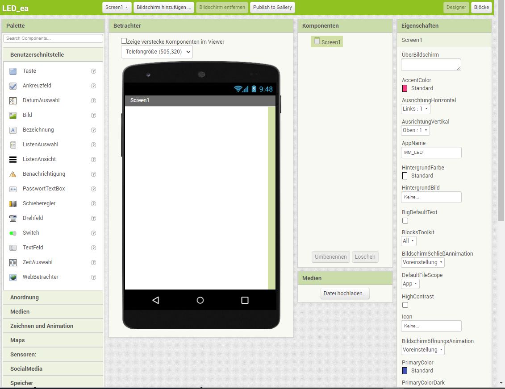
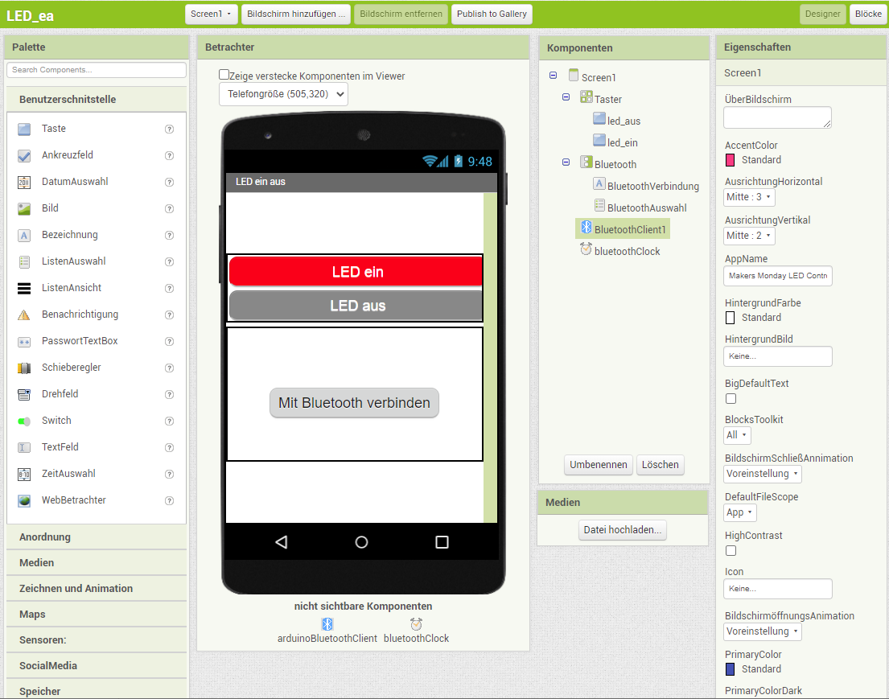
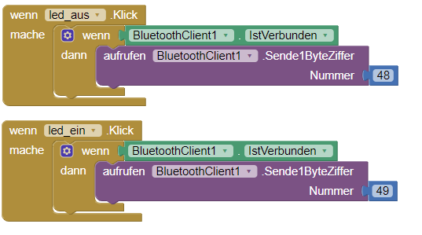
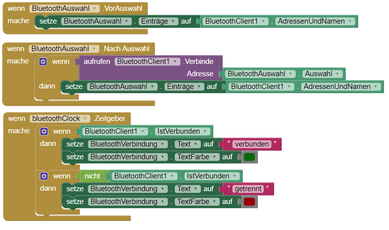
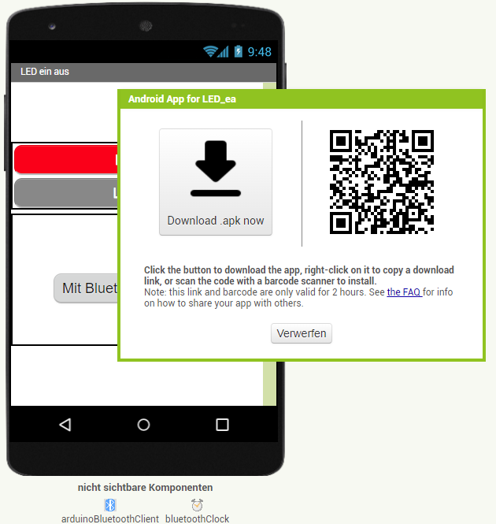

<a name="oben"></a>

<div align="center">

|[:skull:ISSUE](https://github.com/frankyhub/APP_LED_Controller/issues?q=is%3Aissue)|[:speech_balloon: Forum /Discussion](https://github.com/frankyhub/APP_LED_Controller/discussions)|[:grey_question:WiKi](https://github.com/frankyhub/APP_LED_Controller/wiki)||
|--|--|--|--|
| | | | |
<a href="https://github.com/frankyhub/APP_LED_Controller/issues">|<a href="https://github.com/frankyhub/APP_LED_Controller/discussions">|<a href="https://github.com/frankyhub/APP_LED_Controller/6eleases">||
|| <a href="https://github.com/frankyhub/APP_LED_Controller/pulse" alt="Activity">| <a href="https://github.com/frankyhub/APP_LED_Controller/graphs/traffic">  |<a href="https://github.com/frankyhub?tab=stars"> ||

</div>

<ul>
  <font size="+2">
<h3>Einleitung:</h3>

Der <b>MIT App Inventor</b> (MIT = Massachusetts Institute of Technology) ist eine vom US-amerikanischen Unternehmen Google Inc. entwickelte Integrierte Entwicklungsumgebung, um Anwendungen für Android zu programmieren.
  
  Diese Anleitung beschreibt die Erstellung einer Android Handy-App mit dem Online-Editor MIT App-Inventor.
Für die Anmeldung ist eine Email-Adresse oder ein Google-Konto erforderlich. Die fertig programmierte APP wird
mit einem QR-Code Scanner geladen und anschließend auf dem Handy installiert. Etwaige Sicherheitshinweise des
Handys bei der Installtion muss man bei der selbst programmierten APP ignorieren, ansonsten wird die APP nicht installiert. Nach der Installation
wird das C++ Bluetooth-Programm in den NANO oder in den ESP32 geladen und die Bluethooth-Verbindung am Handy
hergestellt.  <br>
 Nach der Betätigung des Taste "Mit Bluetooth verbinden" werden alle Bluetooth-Verbindungen
 aufgelistet und die Verbindung "HC05" (NANO) oder "ESP32GPIO13" (ESP32) aktiviert. Bei korrekter Verbindung
 erscheint der Text "verbunden" in der APP. 
 Mit den APP-Tasten LED-ein und LED-aus kann der Ausgang des Microcontrollers geschalten werden.  
 <br>     


<h3>Start:</h3>
 Durch Eingabe von <a>http://ai2.appinventor.mit.edu/</a> in die Adresszeile eines
Webbrowsers gelangt man zu seinem Google-Konto, über das der Zugang zum "MIT App
Inventor" freigegeben wird. Bei der ersten Anmeldung muss man sich
registrieren und den weiteren Anweisungen folgen. Hilfen gibt es unter der Adresse
<a>http://appinventor.mit.edu/explore/get-started.html</a>.
<br>

Nach
erfolgreichem Start der Anwendung muss zum
Entwickeln einer neuen App in der Titelzeile zunächst auf
"Projects" und dann "Start new project" angewählt
werden. In dem sich öffnenden Fenster einen Namen (z.B.:
LED_ea) eingeben und mit "OK" bestätigen.
<br> <br>
Danach öffnet sich der Editor:


<br>


  
<br><br>

 <!-- ---------------------------------------------------------------------------------->
<h3>Taster einfügen</h3>

Der Editor beinhaltet zwei Ebenen, die "Designer" Ebene für das Layout der APP wie z.B. die Erstellung der Taster
und die Ebene "Blöcke" für das Programm und die Funktionen der APP.
Halbrechts werden in einer Spalte alle Komponenten aufgelistet, die auf
dem Handy im „Betrachter“ platziert sind.
Die Spalte rechts außen zeigt – je nachdem welche Komponente angewählt
ist – deren voreingestellten Details an. Durch Veränderung der Einstellungen
kann deren Erscheinungsbild verändert werden.

<br> <br>

Für die APP, die vom Handy aus eine LED ein- und
ausschalten kann, müssen aus der Palette die fünf benötigten
Komponenten in das Handy auf dem Betrachter-Bildschirm gezogen werden. Der Reihe nach sind das:

 <br>
 
1. Zwei "Taster", um die Schaltvorgänge auslösen zu können. <br>
2. Eine "Bezeichnung", die anzeigt, dass eine Verbindung zum Bluetooth Modul hergestellt worden ist. <br>
3. Eine "ListenAuswahl", die eine Liste generiert, aus der das Bluetooth Modul des Microcontrollers gewählt werden kann.    <br>
4. Ein "BluetoothClient". Er findet sich in der Palette unter "Verbindung". Da er im Hintergrund arbeitet, bleibt er unsichtbar.   <br> 
5. Eine "Uhr", sie befindet sich in der Palette unter "Sensoren", auch sie bleibt unsichtbar.  <br>
  
<br>
<br>


 <br>   <br>

  <br>

 <!-- ---------------------------------------------------------------------------------->
   <h3>Blöcke einfügen</h3>

 Jetzt sind alle Komponenten für die grafische Programmierung vorhanden. Die einzelnen Komponenten könnten noch grafisch optimiert werden.
  Für den Anfang legen wir jedoch das Hauptaugenmerk auf die Funktion und wählen ein einfaches Design. Nachträglich kann das Design natürlich noch
  verändert und verbessert werden. <br>
  Jetzt starten wir mit der Programmierung. Die Programmieroberfläche öffnet sich bei einem Klick auf „Blocks“ in der
grünen Zeile rechts oben.  <br>
<br>
  
   <!-- ---------------------------------------------------------------------------------->
   <h3>Taster und Bluetooth-Verbindung programmieren</h3>
<font size="+1"> Schließlich wird jeder "Taster" mit einer Funktion ausgestattet. Er soll bei einem Klick eine Zahl
über den Bluetooth Client übermitteln. Laut der ASCII-Tabelle ergibt der Dezimalewert "48" den Datentyp Caracter "0", (ausschalten) für den Microcontroller,
  den Dezimalwert "49" wertet der Microcontroller als "1" (einschalten).    <br>
</font>



 <br>   <br>
  
  
Ein Klick auf „Verbindung, BluetoothAuswahl“ öffnet ein Auswahlmenü, bei dem folgende Bausteine ausgewählt werden:

<br>

 

 <br> <br>


 <!-- -------------------------------------------------------------------------------- -->
  
<h3>App erzeugen</h3>

  Unter den Menüpunkt "Erzeugen" wird die Android APP (.apk) ausgewählt und gestartet. Der erzeugte QR-Code
kann mit dem Handy gescannt, geladen und die App installiert werden.  
  
  <br><br>
  


 <br>   <br>

  
 <!-- ---------------------------------------------------------------------------------->
  
<h3>Microcontroller programmiern</h3>

Abschließend das C++ Programm in den Microcontroller laden und starten.
Im Handy sollte der jetzt der Bluetoothteilnehmer (HC05 oder ESP32GPIO13) sichtbar sein.    <br>
Nach entsprechender Auswahl zeigt die APP die erfolgreiche Verbindung an und die LED kann ein/aus geschalten werden. 
<br><br>


 <!-- ---------------------------------------------------------------------------------->
  
 <h3>C++ ESP32 Programm</h3>
  <br>   
 
```C++
// Code
  
  
  
 /************************************************************************************************* 
                                      PROGRAMMINFO
************************************************************************************************** 
Funktion: ESP32 Bluetooth GPIO13 mit APP Makers Monday LED Contoller
**************************************************************************************************
Version: 26.02.2022
**************************************************************************************************
Board: ESP32vn IoT UNO V1.0.4

**************************************************************************************************
C++ Arduino IDE V1.8.13
**************************************************************************************************
Einstellungen:
https://dl.espressif.com/dl/package_esp32_index.json
http://dan.drown.org/stm32duino/package_STM32duino_index.json
https://raw.githubusercontent.com/espressif/arduino-esp32/gh-pages/package_esp32_dev_index.json
*************************************************************************************************
 
 **************************************************************************************************/
#include "BluetoothSerial.h"

#if !defined(CONFIG_BT_ENABLED) || !defined(CONFIG_BLUEDROID_ENABLED)
#error Bluetooth is not enabled! Please run `make menuconfig` to and enable it
#endif

BluetoothSerial SerialBT;
int led = 13;    // LED Ausgang 13 
int state;       // LED Status
//--------------------------------------------------------------


void setup() {

  SerialBT.begin("ESP32GPIO13"); //Bluetooth device name
  Serial.println("ESP32GPIO13 wurde gestartet!");

    pinMode(led, OUTPUT);
    digitalWrite(led, LOW); 
    Serial.begin(9600);
    
}

void loop() {
    //Wert auslesen und speichern
    if(SerialBT.available() > 0){     
     state = SerialBT.read();   

    }   
    // Wenn der Status 0 ist -> LED aus
    if (state == '0') {
        digitalWrite(led, LOW); 

    }
    
    // Wenn der Status 1 ist -> LED ein
    else if (state == '1') {
        digitalWrite(led, HIGH); 

    }

    //LED Status
    Serial.println(state);
}
 
//-------- END ----------------

```
  
  
   <br>   <br>  
  
   <!-- ---------------------------------------------------------------------------------->

   
<h3>C++ NANO Programm</h3>

      
  <br>   

```C++
// Code
  
  
/************************************************************************************************* 
                                      PROGRAMMINFO
************************************************************************************************** 
Funktion: LED Controller
Vor dem Programm hochladen RX und TX Verbindung lösen!!!!!!!!!!!!!!!
Bluetooth mitHC05 koppeln
NANO-Shield 2022 V1 D0 RXT D1 TXT
LED an D11

**************************************************************************************************
Version: 27.02.2022
**************************************************************************************************
Board: NANO V3 
HC 05 Bluetooth Wireless RF-Transceiver-Modul RS232 
**************************************************************************************************
C++ Arduino IDE V1.8.13
**************************************************************************************************
Einstellungen:
https://dl.espressif.com/dl/package_esp32_index.json
http://dan.drown.org/stm32duino/package_STM32duino_index.json
https://raw.githubusercontent.com/espressif/arduino-esp32/gh-pages/package_esp32_dev_index.json
**************************************************************************************************
**************************************************************************************************/
int led = 11;    // LED Ausgang 11 
int state;       // LED Status


void setup() {

    pinMode(led, OUTPUT);
    digitalWrite(led, LOW); 
    Serial.begin(9600);
}

void loop() {
    //Wert auslesen und speichern
    if(Serial.available() > 0){     
     state = Serial.read();   

    }   
    // Wenn der Status 0 ist -> LED aus
    if (state == '0') {
        digitalWrite(led, LOW); 

    }
    
    // Wenn der Status 1 ist -> LED ein
    else if (state == '1') {
        digitalWrite(led, HIGH); 

    }

    //LED Status
    Serial.println(state);
}
  
  
  
  
//-------- END ----------------

```
  
  
   <br>   <br>    
  
  
    
  


  </font>


<!-- --------------------------------------------------------- -->
<div class="clear"></div>
<br>

---

<div style="position:absolute; left:2cm; ">   
<ol class="breadcrumb" style="border-top: 2px solid black;border-bottom:2px solid black; height: 45px; width: 900px;"> <p align="center"><a href="#oben">nach oben</a></p></ol>
</div>  

---
